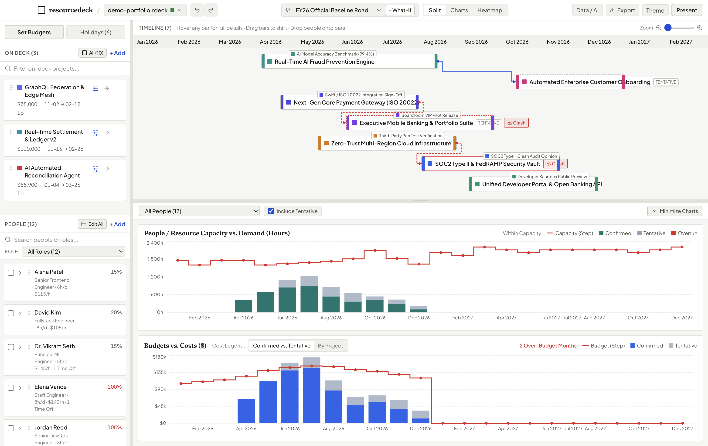
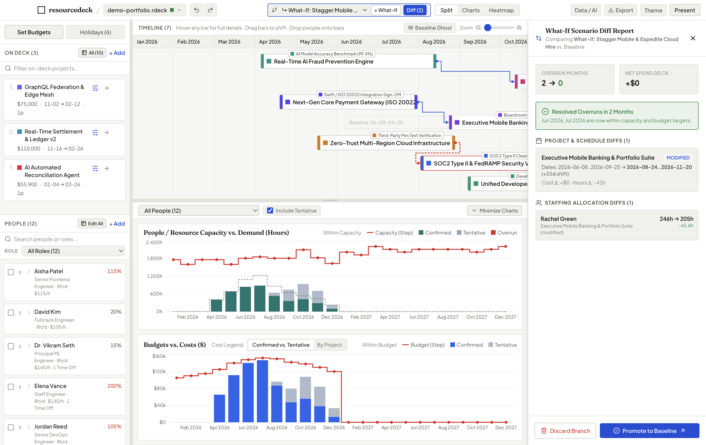
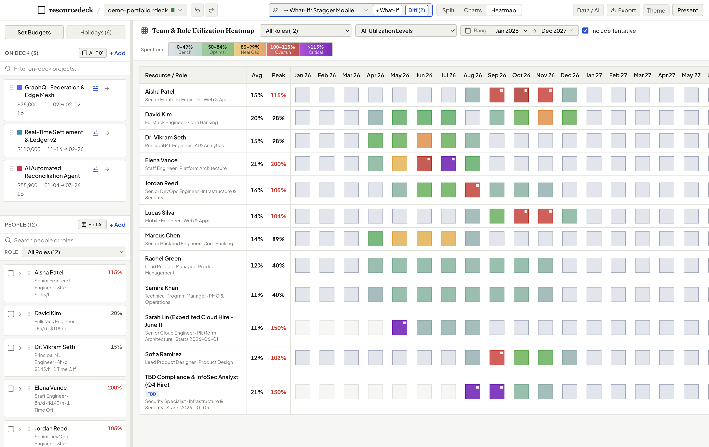
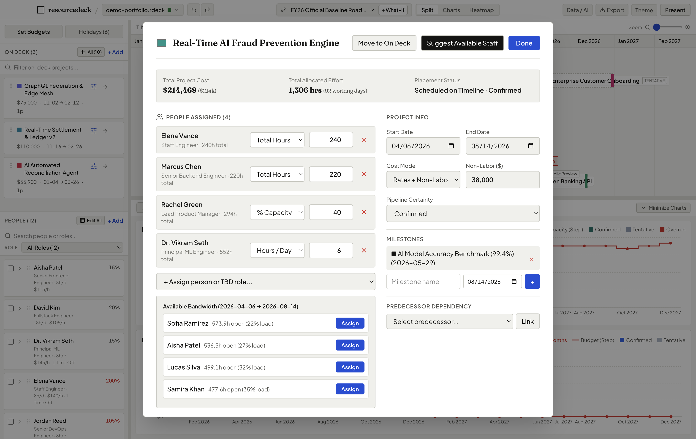
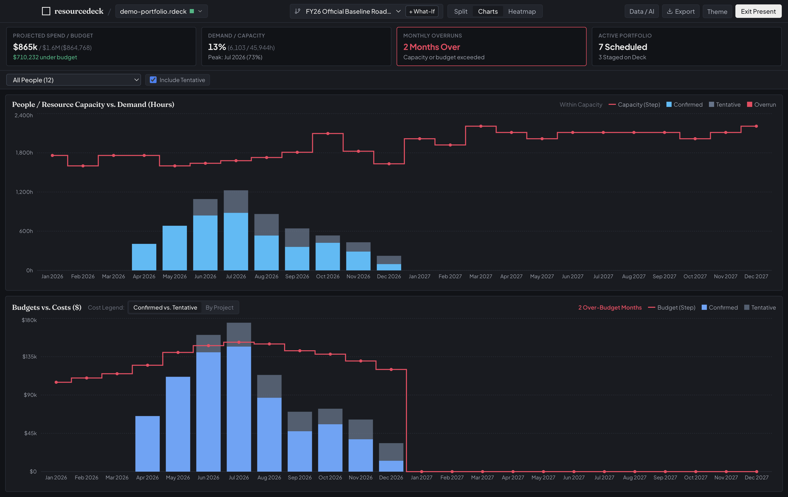
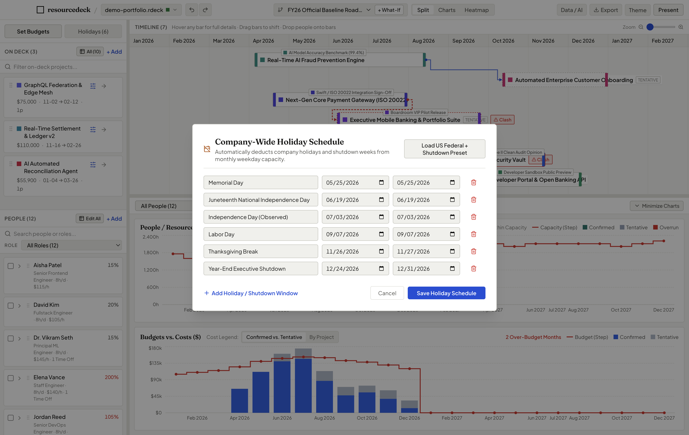
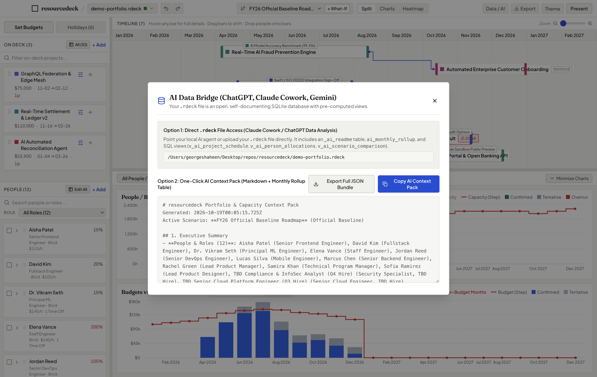

<div align="center">

# resourcedeck

### Sophisticated resource capacity and portfolio planning. Made simple.

**Free & Open Source Forever** · **100% Offline & Private** · **No Per-Seat Pricing**

[](https://opensource.org/licenses/MIT)
[](#downloads--installation)
[](https://resourcedeck.app)
[-success.svg)](#privacy--data-ownership)

<br/>

<p align="center">
  <a href="#key-capabilities">Key Capabilities</a> •
  <a href="#screenshot-walkthrough">Screenshots</a> •
  <a href="#the-core-triad-people-projects-budgets">The Core Triad</a> •
  <a href="#compare-tools">Compare Tools</a> •
  <a href="#downloads--installation">Download</a> •
  <a href="https://resourcedeck.app">Website</a>
</p>

---

</div>

## Overview

**resourcedeck** is a free, open-source desktop application built specifically for **Project Managers, Resource Management Professionals, PMO Leaders, and Portfolio Decision-Makers** who need to balance organizational capacity against project demand without spreadsheet fragility or bloated enterprise PPM software.

Instead of fighting broken VLOOKUPs or paying $60/user/month for enterprise tools that take six months to configure, resourcedeck lets you **capture your people, projects, and budgets in one place**, test What-If scenarios safely against an approved baseline, and walk into boardroom reviews with instant answers to *"Can we take on this project?"*

---

## Why PMOs and Project Managers Choose resourcedeck

* **Free and Open Source Forever**: Published under the permissive MIT license. No per-seat licenses, no user caps, no feature paywalls, and no subscription fees for your team.
* **100% Offline & Private**: Zero telemetry. Your project budgets, employee names, and billing rates never touch a cloud server. Everything is stored locally in an open, portable `.rdeck` SQLite file that you own forever.
* **Instant Boardroom Answers**: When executives ask *"What happens if we push Project X to Q4?"*, answer in seconds with dynamic What-If scenario branching and visual ghost bars.
* **Realistic Working Calendars**: Automatically prorates weekdays, skips weekends, and deducts company holidays and personal PTO for accurate month-by-month hours.

---

## The Core Triad: People, Projects, Budgets

resourcedeck unifies the three pillars of organizational delivery into a single deterministic calculation engine:

```
           ┌──────────────────────────────────────────────┐
           │                 resourcedeck                 │
           │       Single-File Desktop Workbench (.rdeck) │
           └──────────────────────┬───────────────────────┘
                                  │
         ┌────────────────────────┼────────────────────────┐
         ▼                        ▼                        ▼
  ┌──────────────┐         ┌──────────────┐         ┌──────────────┐
  │ YOUR PEOPLE  │         │YOUR PROJECTS │         │ YOUR BUDGETS │
  │   (Supply)   │   VS.   │   (Demand)   │   WITH  │ (Financials) │
  └──────────────┘         └──────────────┘         └──────────────┘
  • Real Staff & Roles     • Scheduled Gantt Bars   • Monthly Ceilings
  • TBD Role Placeholders  • "Projects on Deck"     • Overrun Red Alerts
  • Skill Tags & Rates     • Milestones & Precedence• Variance Tracking
  • Company Holidays & PTO • Flexible Allocations   • Burn Rate Forecasts
```

1. **Your People (Capacity Supply)**: Model real team members, departments, skill tags, billing rates, and daily working hours. Plan future headcount with `TBD` role hiring placeholders and future start dates.
2. **Your Projects (Portfolio Demand)**: Stage candidate backlog initiatives in *Projects on Deck*, drag them onto the active timeline, set strategic ROI value scores, and connect milestones and project dependencies.
3. **Your Budgets (Financial Limits)**: Set monthly budget ceilings and watch projected costs update in real time. Over-allocations and budget overruns highlight in **Overrun Red** before you make commitments.

---

## Screenshot Walkthrough

### 1. Interactive Portfolio Gantt & Dual Analytics
Synchronized view of your project timeline alongside live-updating *People Capacity vs. Demand (Hours)* and *Budgets vs. Costs ($)* charts with automatic **Overrun Red** alerts.



---

### 2. "What-If" Scenario Branching & Baseline Ghost Bars
Fork your approved baseline in one click to test staffing reallocations, project slips, or scope shifts. Dashed **Baseline Ghost Bars** show original dates on the Gantt, while the **Scenario Diff Drawer** summarizes net hour deltas and cost impacts with 1-click promotion to Baseline.



---

### 3. Team & Role Utilization Heatmap
View your organization across months in an intuitive matrix. Color-coded thresholds instantly identify under-allocated bench capacity (`<70%`), optimal load (`70–100%`), and critical bottlenecks (`>100%`), with single-click drill-downs into individual project hours.



---

### 4. Smart Staffing & Skills Matching
Assign team members using Total Hours, Hours/Day, or % Capacity. When staffing an initiative, click **"Suggest Available Staff"** to rank team members and `TBD` role placeholders by skill tag match and open capacity in that specific window.



---

### 5. Distraction-Free Boardroom Presentation Mode (`⌘P`)
Press **`Cmd/Ctrl + P`** to collapse sidebars and toolbars for executive steering committees and live Zoom reviews. Features high-contrast themes (**Boardroom Daylight**, **Executive Slate Dark**, **Warm Paper**) with tabular numerals for effortless legibility.



---

### 6. Realistic Availability & Calendar Math
Automatically deducts company-wide federal holidays, executive shutdown windows, and individual team member PTO with exact weekday proration.



---

### 7. 1-Click AI Data Bridge (`⌘+Shift+A`)
Every `.rdeck` file is an open, self-documenting SQLite database. Tap **`Cmd/Ctrl + Shift + A`** to generate a clean Markdown context pack with pre-computed monthly rollups ready to paste into ChatGPT, Claude Cowork, or Gemini for instant portfolio risk analysis.



---

## Compare Tools: Spreadsheets vs. Enterprise PPMs vs. resourcedeck

| Capability | resourcedeck | Excel / Google Sheets | Enterprise Cloud PPM |
| :--- | :--- | :--- | :--- |
| **Pricing & License** | **Free & Open Source Forever** (MIT) | Part of Office / Workspace | $50–$100+ / user / month |
| **Gantt Scheduling** | **Tactile drag-and-drop** with auto-proration | Rigid cell date formulas | Heavy, slow web interface |
| **What-If Scenarios** | **1-Click branch, ghost bars & diff drawer** | Fragile duplicate workbook tabs | Complex administrator setup |
| **Overrun Alerts** | **Instant visual red** for capacity & budget | Manual conditional formatting | Delayed batch syncs |
| **Onboarding Time** | **< 2 minutes** (Download & run) | Weeks of template maintenance | 3 to 6 months implementation |
| **Data Privacy** | **100% Offline** (Single `.rdeck` file) | Cloud drive sharing | Vendor cloud database lock-in |
| **Telemetry** | **Zero Telemetry** | Cloud usage tracking | Extensive vendor telemetry |

---

## Downloads & Installation

Download the latest standalone desktop application for your operating system:

* **[Download for macOS (.dmg)](https://github.com/gshaheen/resourcedeck/releases/latest/download/resourcedeck-mac.dmg)** (Universal binary: Apple Silicon & Intel)
* **[Download for Windows (.exe)](https://github.com/gshaheen/resourcedeck/releases/latest/download/resourcedeck-win.exe)** (64-bit installer for Windows 10/11)

No servers to configure, no cloud accounts, and no complex setup. Download the installer, double-click to install, and start planning immediately.

Every plan is a single portable `.rdeck` file—easy to back up, share over corporate drives, or store in Git. Open the included `demo-portfolio.rdeck` sample directly from the app to explore a pre-populated, realistic portfolio.

---

## Development & Building from Source

For engineers and contributors building from source:

```bash
# Clone the repository
git clone https://github.com/gshaheen/resourcedeck.git
cd resourcedeck

# Install dependencies and launch in development mode
npm install
npm run dev

# Re-seed the realistic demo portfolio (demo-portfolio.rdeck)
npm run demo:seed

# Run the automated headless screenshot capture engine
npm run screenshots

# Run unit tests (< 1 second)
npm test

# Typecheck and build production bundles
npm run typecheck
npm run build
```

---

## Privacy & Open Source Commitment

* **Open Source**: Licensed under the [MIT License](./LICENSE). You are free to inspect, modify, and distribute it across your organization without restriction.
* **Zero Telemetry**: No trackers, no cookies, no analytics SDKs, and no cloud call-homes. Download counts are tracked solely through GitHub Release asset counters.
* **Data Ownership**: Your `.rdeck` files belong to you forever. Because they are standard SQLite databases, you can query them with Python, SQL clients, or external AI tools at any time.

---

<p align="center">
  Visit <a href="https://resourcedeck.app">resourcedeck.app</a> to learn more.
</p>
